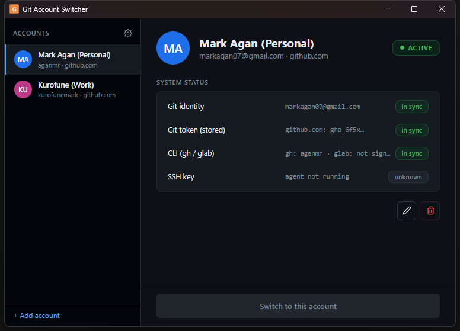

# Git Account Switcher

by Mark Agan

A small Windows desktop app that switches your **entire git setup between accounts with one click** — git identity, stored tokens, and your CLI tools (`gh` / `glab`) all switch together.

Built with [Tauri 2](https://tauri.app) + React.



## Features

- **One-click switching** — updates the git credential slot (identity + token) for the provider host in a single action
- **CLI sync** — keeps `gh` (GitHub) and `glab` (GitLab) signed in to the account you just switched to
- **Browser login, no token needed** — GitHub accounts can log in via the browser (device flow through `gh auth login`); no pasting tokens
- **Automatic re-auth** — if a stored token is rejected (revoked, expired, or missing a scope), the switch falls back to a browser login automatically and stores the fresh token
- **Import existing credentials** — picks up git credentials already saved on your machine
- **Export / import account set** — move your accounts between machines as a single file
- **Per-provider status** — live view of git identity, stored token, CLI login, and SSH key, each marked in sync / out of sync
- Launch at startup, close to tray, in-app dialogs (no native prompts)

## Supported providers

| Provider | Support | Notes |
| --- | --- | --- |
| GitHub | ✅ Full | token switch, `gh` CLI sync, browser device-flow login |
| GitLab | ✅ Token | token switch, `glab` CLI sync — browser auto-login via `glab` is planned (see below) |
| Gitea / Forgejo | ✅ Token | token switch |
| Gitee | ✅ Token | token switch |
| Azure DevOps | 🚧 Future | PAT-based — the org goes in the host field; no CLI sync, no browser login (PATs are created on the website) |
| Bitbucket & others | 🚧 Future | may be supported in a future update |
| AWS CodeCommit | ❌ Not planned | no token API — auth goes through AWS SSO / `git-credential-helper`, so there is no token for the app to switch |

## Future updates

- **GitLab browser auto-login** via `glab` (the same tokenless flow GitHub already has)
- **Version checker / auto-update** — notice when a new release is available
- **CLI for AI agents** — a command-line interface that lets AI agents (and scripts) switch git accounts autonomously

## Install

Download the latest **NSIS installer** (`.exe`) from the [Releases](https://github.com/aganmr/git-account-switcher/releases) page.

- Installs **per user** — no administrator / UAC prompt
- The app is **not code-signed**, so Windows SmartScreen may show a warning on first install. Choose *More info → Run anyway*

## Security notes

- Account metadata is stored in an **AES-256-GCM-encrypted** `accounts.json` in the app data folder (the path is shown in Settings) — the file holds no tokens
- Tokens live in the **Windows Credential Manager** — one entry per account, tagged with the account's username and identity, also protected per-user by the OS
- Switching writes the active account's identity + token to the git credential slot (`git:https://{host}`), the standard location git itself reads from
- Nothing is uploaded anywhere; all operations are local

## Build from source

Requires the [Tauri 2 prerequisites](https://v2.tauri.app/start/prerequisites/) (Rust, Microsoft Visual Studio C++ Build Tools, WebView2).

```powershell
npm install
npm run tauri dev      # development
npm run tauri build    # release → src-tauri/target/release/bundle/nsis/
```

## Report an issue

[Open an issue](https://github.com/aganmr/git-account-switcher/issues).
